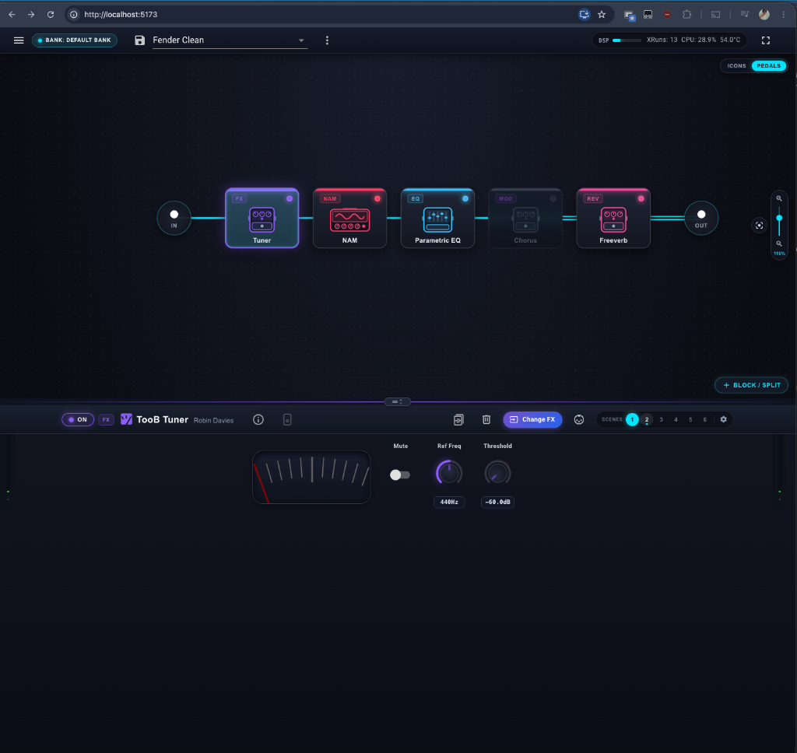
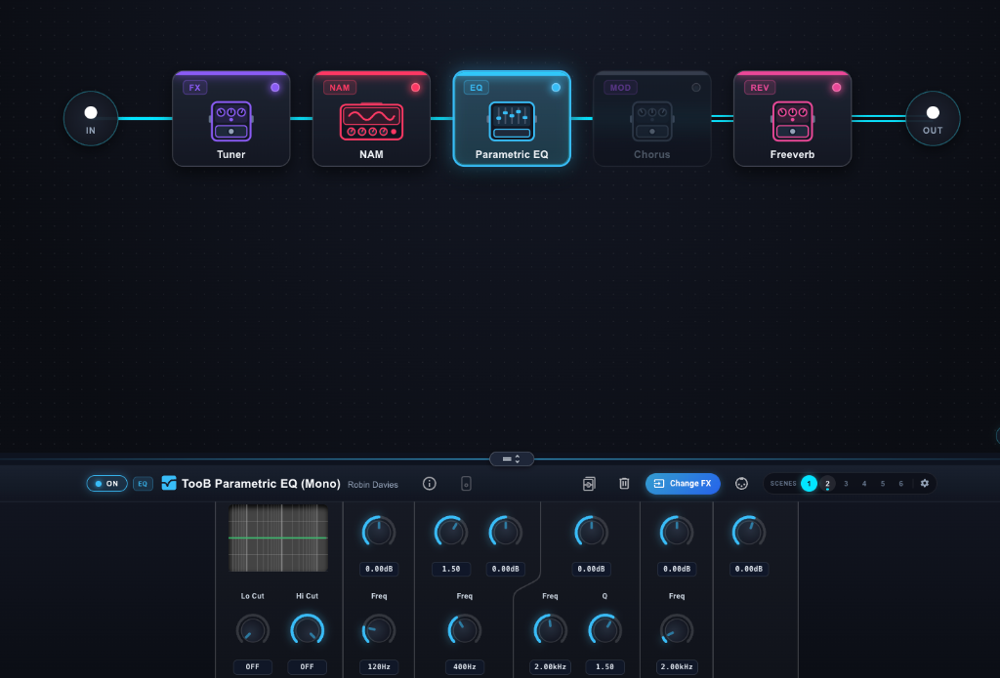
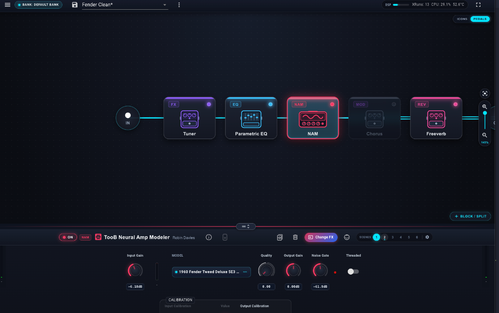

# PiPedal Studio UI

> **Important Notice — UI-Only Fork**
>
> **PiPedal Studio** is a **Web UI-only customization fork** of **[PiPedal](https://github.com/rerdavies/pipedal)** by [Robin Davies (`rerdavies`)](https://github.com/rerdavies).
>
> This fork **only changes the frontend React/Vite interface** (`vite/src/pipedal/`) to give it a modern desktop/touch rig-editor look and feel. The underlying C++ real-time audio engine, LV2 host, Neural Amp Modeler (NAM A2) integration, system services, and installers are **completely unchanged**.
>
> For installation, system requirements, audio configuration, LV2 plugin support, downloads, and official documentation, please check the original project:
> - **Original Repository:** [https://github.com/rerdavies/pipedal](https://github.com/rerdavies/pipedal)
> - **Official Website & Docs:** [https://rerdavies.github.io/pipedal/](https://rerdavies.github.io/pipedal/)
> - **Official Releases & Downloads:** [https://rerdavies.github.io/pipedal/download.html](https://rerdavies.github.io/pipedal/download.html)

---

## Goal of the UI Redesign

The goal of **PiPedal Studio** is to modernize the browser and touch interface of PiPedal, taking visual and ergonomic inspiration from modern hardware/desktop guitar rig editors such as the **HeadRush FX Remote Editor**, **HeadRush Flex Prime (v5.2)**, and **Lava Studio**.

### Screenshots



| Parametric EQ & Centered Signal Chain | Neural Amp Modeler (NAM) & Rotary Arc Controls |
| :---: | :---: |
|  |  |

---

## What Changed in the UI

- **Studio Signal-Chain Stage (`PedalboardView`, `MainPage`)**
  - Dark dot-grid canvas with centered signal path and glowing stereo/mono connector lines.
  - Color-coded FX category badges (`AMP`, `NAM`, `CAB`, `OD`, `MOD`, `DLY`, `REV`, `EQ`, `COMP`, `FX`) with LED status indicators.
  - **Icons / Pedals View Switch**: Toggle between classic minimal icons and lightweight inline SVG hardware illustrations (stompboxes, amp heads, NAM profiler units, cabinets, and studio rack gear).
  - **Interactive Pan, Zoom & Auto-Fit Center**: Drag the canvas with the mouse/touch to pan, use the pinned vertical zoom slider (`65%`–`145%`) or mouse wheel to zoom, and click the **Center** button to automatically fit and center the entire FX chain.
  - **Animated Drag-and-Drop Reordering & Trash Drop Zone**: Dragging an effect block displays an animated insertion preview between blocks and reveals a dedicated top **Drop to Remove** trash zone (preventing accidental deletions when dragging outside the chain).
  - **Frosted-Glass Bypass State**: Disabled effects apply a frosted `backdrop-filter: blur` over the underlying signal line for clear visual separation.
- **Resizable Split Layout**
  - Draggable split handle between the upper FX chain stage and the bottom parameter deck so you can size both panels to fit your screen, with automatic scrolling in the bottom deck.
- **Inspector Bar & Quick Scenes (`MainPage`)**
  - Hardware-style `ON / BYPASS` pill button, category badge, `Change FX` button, and a 1–6 **Scenes** quick-select bar with integrated settings cog.
- **Touch-Friendly Rotary Arc Dials & Meters (`PluginControl`, `PluginOutputControl`, `VuMeter`)**
  - Larger rotary knobs with glowing 270° SVG value arcs, wider numeric readout pills, rounded tuner & spectrum displays, and capsule-styled input/output VU meters.
- **Redesigned Plugin Browser (`LoadPluginDialog`)**
  - Category filter pills, color-coded plugin cards, and a dedicated `(i)` info popover button on each card to inspect full plugin descriptions without cluttering the grid.

---

## Running the Web UI Locally (Development)

The Vite development server connects to a running PiPedal backend instance on your network (configured via `vite/vite.config.ts`):

```bash
cd vite
npm install
npm run dev
```

Then open `http://localhost:5173` in your browser.

---

## Credits & License

All credit for **PiPedal**, the **TooB LV2 plugin suite**, and the underlying audio architecture belongs to **[Robin E. R. Davies](https://github.com/rerdavies/pipedal)**. Licensed under the [MIT License](https://rerdavies.github.io/pipedal/LicensePiPedal.html).
